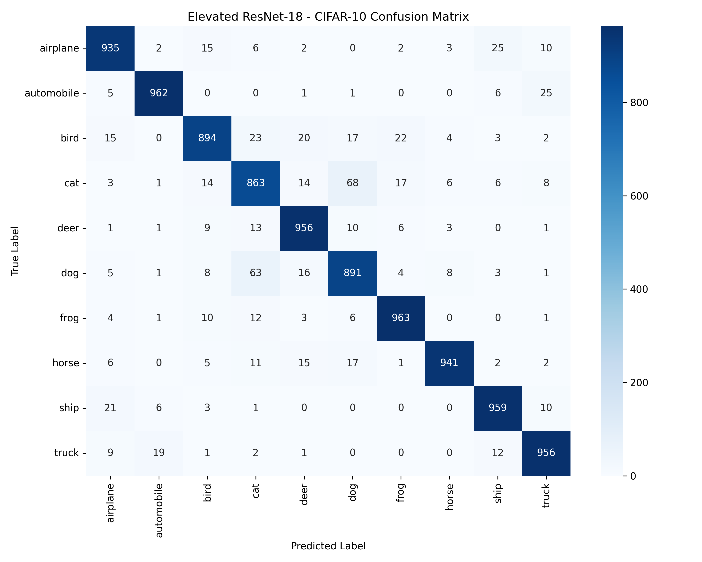

[](https://kanishk-resnet18-cifar10-from-scratch.streamlit.app)
[](https://github.com/kanishkdeep01/resnet18-cifar10-from-scratch)

# From-Scratch ResNet-18 Implementation on CIFAR-10

# From-Scratch ResNet-18 Implementation on CIFAR-10

A hand-built PyTorch implementation of the ResNet-18 architecture trained on CIFAR-10, engineered with custom data augmentation pipelines, L2 regularization, and Cosine Annealing learning rate scheduling to achieve a **93.20% test accuracy** (6.80% test error).



---

## Performance Progression

The model was developed iteratively, logging performance across architectural and optimization changes:

| Iteration | Architecture & Strategy | Test Accuracy | Test Error |
| :--- | :--- | :---: | :---: |
| **Baseline** | Simple 3-Layer Convolutional Network (No residual links, un-augmented) | 74.88% | 25.12% |
| **Un-augmented ResNet** | Hand-built ResNet-18 (10 epochs, raw CIFAR-10 data) | 82.77% | 17.23% |
| **Final ResNet-18** | ResNet-18 (50 epochs + Augmentations + Adam + Cosine Annealing) | **93.20%** | **6.80%** |

---

## Academic Context & Paper Alignment

This project reproduces and adapts the residual learning framework introduced by **He et al. (2015)** (*Deep Residual Learning for Image Recognition*, [arXiv:1512.03385](https://arxiv.org/abs/1512.03385)).

While the original paper evaluates specialized ResNet variants for CIFAR-10 ($N \in \{2, 3, 5, 9\}$ yielding 20, 32, 56, and 110 layers), this repository adapts the standard **ResNet-18** architecture for $32 \times 32$ images by replacing the large initial $7 \times 7$ conv/max-pool stem with a single $3 \times 3$ conv layer (stride 1, padding 1).

### Comparative Benchmark
With a **6.80% test error**, this ResNet-18 implementation sits directly between the original paper's ResNet-56 and ResNet-110 CIFAR-10 benchmarks (Table 6 in He et al.):
* **ResNet-56 (Paper):** 6.97% test error
* **ResNet-18 (This Implementation):** **6.80% test error**
* **ResNet-110 (Paper):** 6.41% test error

### Key Implementation Differences

| Aspect | Original Paper (He et al.) | This Implementation |
| :--- | :--- | :--- |
| **Optimizer** | SGD with Momentum (0.9) | Adam (`lr=1e-3`, `weight_decay=1e-4`) |
| **LR Schedule** | Step decay (divide by 10 at 32k & 48k steps) | `CosineAnnealingLR` |
| **Training Budget** | 64k iterations (~182 epochs) | 50 epochs |
| **Dataset Split** | 45k train / 5k validation split | Full 50k train / 10k test split |
| **Shortcut Connections** | Option A (Identity + Zero-padding for expansion) | Option B ($1 \times 1$ conv projections for dimension changes) |

---

## Per-Class Evaluation Metrics

Evaluated across 10,000 held-out test images:

| Class | Precision | Recall | F1-Score | Support |
| :--- | :---: | :---: | :---: | :---: |
| **Airplane** | 0.9313 | 0.9350 | 0.9331 | 1000 |
| **Automobile** | 0.9688 | 0.9620 | 0.9654 | 1000 |
| **Bird** | 0.9322 | 0.8940 | 0.9127 | 1000 |
| **Cat** | 0.8682 | 0.8630 | 0.8656 | 1000 |
| **Deer** | 0.9300 | 0.9560 | 0.9428 | 1000 |
| **Dog** | 0.8822 | 0.8910 | 0.8866 | 1000 |
| **Frog** | 0.9488 | 0.9630 | 0.9558 | 1000 |
| **Horse** | 0.9751 | 0.9410 | 0.9578 | 1000 |
| **Ship** | 0.9439 | 0.9590 | 0.9514 | 1000 |
| **Truck** | 0.9409 | 0.9560 | 0.9484 | 1000 |
| **Overall Accuracy** | — | — | **0.9320** | **10000** |

---

## Architectural Details

* **From-Scratch Modules:** Hand-built `BasicBlock` modules featuring $3 \times 3$ convolutional layers, Batch Normalization, residual skip-connections, and explicit $1 \times 1$ projection shortcuts for spatial downsampling.
* **Regularization & Optimization Pipeline:**
  * **Augmentation:** `RandomCrop(32, padding=4)` and `RandomHorizontalFlip()` applied strictly during training.
  * **Weight Decay:** L2 penalty (`weight_decay=1e-4`) applied via Adam optimizer to prevent parameter memorization.
  * **Learning Rate Scheduling:** `CosineAnnealingLR` scheduler decaying smoothly over 50 epochs.
* **Inference Pipeline & Input Defense (`app.py`):** Interactive Gradio web interface with input sanitization—incorporating automated $32 \times 32$ image resizing and channel normalization $(\mu, \sigma)$ matching the CIFAR-10 dataset statistics to eliminate out-of-distribution runtime errors.

---

## Repository Structure

```text
├── dataset.py                  # Augmentations & CIFAR-10 DataLoaders
├── model_resnet.py             # ResNet-18 architecture implementation
├── train.py                    # 50-epoch training loop & checkpointing
├── evaluate.py                 # Per-class metrics & confusion matrix generator
├── app.py                      # Gradio web application with defense pipeline
├── elevated_resnet_cifar10.pth # Saved model weights
├── confusion_matrix.png        # Generated evaluation heatmap
└── requirements.txt            # Python dependencies
```

---

## Quickstart

### 1. Installation
Clone the repository and install the required packages:
```bash
git clone https://github.com/kanishkdeep01/resnet18-cifar10-from-scratch.git
cd resnet18-cifar10-from-scratch
pip install torch torchvision gradio scikit-learn seaborn matplotlib
```

### 2. Model Evaluation
Generate the per-class performance report and save `confusion_matrix.png`:
```bash
python evaluate.py
```

### 3. Launch Web Interface
Boot the local interactive Gradio interface:
```bash
python app.py
```